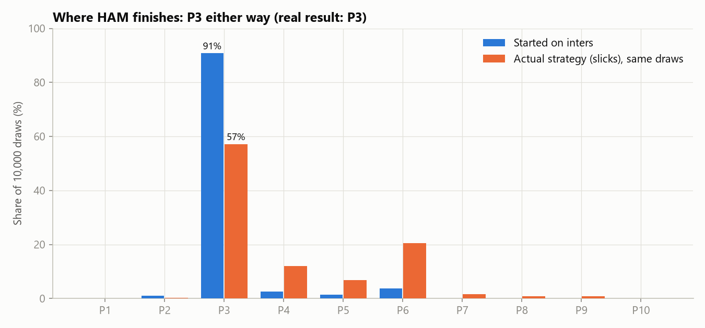
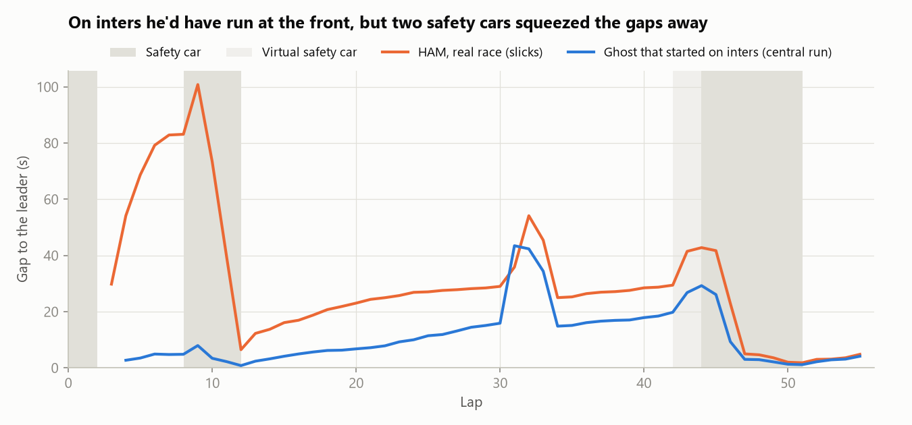
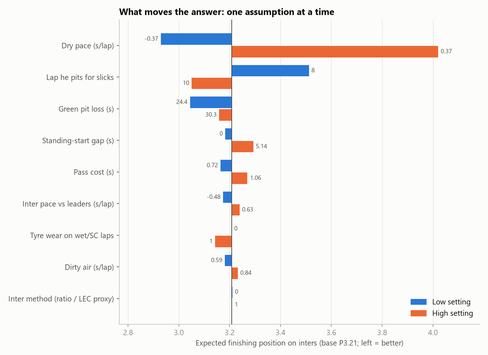

# What if Hamilton had started on inters?

**A data-driven counterfactual of the 2026 Bahrain Grand Prix (Round 16, held at Sepang).** Ferrari started both cars on slicks on a wet track. Hamilton dropped from P2 on the grid to P17 by lap 4, and was 83 s behind the leader after lap 8. He still finished P3.

The question: **where would he most likely have finished had he started on intermediates?**

## The answer: P3 again, but a far safer P3

| 10,000 Monte Carlo draws, seed 16 | Expected finish | P3 | Podium | Win | Gap to winner (median) |
|---|---|---|---|---|---|
| **Started on inters** | **P3.17** | 90.8% | 91.9% | 0.02% | 4.16 s |
| Actual strategy (slicks), same draws | P4.03 | 57.1% | 57.4% | 0.01% | 6.09 s |

Each draw races both strategies with the same sampled pace, traffic, pit-stop and noise inputs, so the comparison is like for like. Draw by draw, inters give:
- **the same position in 60.1%** of draws;
- a better one in 39.4%;
- a worse one in 0.5%.

That's **+0.85 places** on average, and a median of 1.51 s at the flag.

**How to read it against what really happened.** His real race ended P3, but the same model gets his real (slicks) strategy to P3 in only 57.1% of races. He had to pass a dozen cars cleanly and avoid a slow stop, and his P3 sits at the lucky end of what that strategy could produce. On inters he'd have run near the front from the start, and P3 is close to guaranteed. Against his single real P3, the inters average comes out at −0.17 places, because the simulation includes the risk of a slow pit stop his real race didn't have.



### Why it's P3 either way

1. **On inters he'd have run near the front.** By lap 8 the ghost car is P1–P4 in 91.2% of draws, mostly P4 (75.7%), behind VER, ANT and RUS. His estimated inter pace is about level with the leaders'.
2. **The lap-9 safety car freezes that order.** The leaders all switched to slicks under it: 18 of the 20 other cars still running pitted that lap, so the stop gains or costs nobody anything. The same SC cut the real Hamilton's 83 s deficit to 6.5 s, but left him P15 with a field to pass.
3. **The dry race decides.** Against his first-stint pace, VER was 0.86 s/lap faster and ANT 0.62 s/lap. On inters he runs P4 behind them and RUS at lap 42 (59.2% of draws).
4. **Russell retires and the late VSC and SC (laps 43–51) bunch the field**, which turns that P4 into P3 at the flag.
5. **On slicks the risk is all in the comeback.** Passing costs about 0.9 s a car and dirty air about 0.7 s a lap, and he had a dozen cars to get through.



### What moves the answer



One assumption at a time, set to a low and a high value (1,000 draws each, same seed). The bar is the change in his expected finishing position on inters.
- **Dry pace dominates.** ±0.37 s/lap (about the uncertainty in his pace) moves the expected finish from P2.93 to P4.02: a swing of 1.09 places.
- **Next comes the lap he pits for slicks** (swing 0.46). A lap early, on lap 8, means a green stop while everyone else waits for the SC.
- **Everything else moves it by 0.12 places or less**, including the inter-pace inputs (swing 0.07), which are what the question is about. The lap-9 SC wipes out whatever he gains or loses on inters. Both pit-loss settings beat the base case, because the base case also samples the rare 40–52 s stops.

## How the model works

1. **Data:** FastF1 (`2026, round 16, 'R'`). Every fact is checked against the official classification first. FastF1 has Leclerc's lap times 19.4 s late on every lap, so they are shifted to match the official result (see the correction below).
2. **Race phases:** wet laps 3–8, slicks from the lap-9 SC, then the dry race, then the late VSC/SC.
3. **Dry pace:** one regression over every car's clean dry laps: tyre compound + wear × tyre age + fuel/track evolution + a driver offset. **Hamilton's pace is fitted per tyre stint:** he was quicker on his mediums (−0.41 ± 0.47 s/lap) and in the final sprint (−1.20 ± 0.45 s/lap) than in his first stint. Lap effects capture what the whole field felt on each lap (the track still drying on laps 13–16).
4. **Inter pace:** Hamilton never ran inters. His pace on them is Leclerc's inter laps adjusted by their dry-pace gap, blended with a cross-check (his dry gap to the leaders, scaled to wet lap times). The two agree: **+0.08 ± 0.43 s/lap** against the leaders' median inter lap.
5. **Ghost-car simulator** (`src/simulator.py`, generic): races one car lap by lap against the other cars' *recorded* times.
   - **Traffic** has two costs, both measured on the other drivers: **0.89 s per car passed** and **0.71 s per lap in dirty air** (within 1 s of a car ahead). A car that can't get past is held up behind it.
   - **Under the SC or VSC** the ghost copies the real cars around it on the road.
   - **A stop under the SC/VSC** copies the cars that really stopped that lap.
   - **A green stop** costs the median of the others' stops, 26.8 s.
6. **The counterfactual** changes only the start tyre:
   - a standing-start gap sampled from the inter starters near the front (0–5.14 s);
   - laps 4–8 at the leaders' inter pace plus his offset;
   - a pit stop for slicks under the lap-9 SC;
   - then his own real dry strategy, at his real per-stint pace.
7. **Monte Carlo:** 10,000 paired draws. Each samples the inter pace, the dry-fit coefficients, the traffic costs, the pit loss, the start gap and lap-to-lap noise.

## Validation

- **Back-test (Hamilton):** replaying his *actual* strategy from lap 8 through the same engine gives **P3** (real: P3) and **+0.65 s at the flag**; the tolerance is ±5 s. At lap 42, before the late SC resets the gaps, it is **5.09 s off at lap 42**: 0.09 s over the limit. The limit was set before the result and is kept. The miss comes from his first-stint pace and from using the typical pit-stop time for his lap-31 stop.
- **Honesty notes:**
  - The back-test uses his own pace in every stint, so it checks the traffic, safety-car and pit-stop machinery, not the pace.
  - Two parts were added after a back-test failed: the dirty-air cost, and the per-stint pace. Each was measured on the data and fixed before re-running.
- **Second check (Leclerc):** replaying Leclerc's actual race gives **P4** (real P4) and **−1.67 s** at the flag, but it is **−18.58 s** off at lap 42. His only stint the fit can separate is on a tyre FastF1 records as unknown, so he keeps one pace for the whole race.

## A correction

An earlier version (commit `a9d77bc`) said starting on inters would have made almost no difference. That version had a data error.
- **The error:** FastF1 has Leclerc's lap times 19.4 s late on every lap. I had corrected them only from lap 48, where the error showed up against the official result.
- **How it was found:** building a race replay from the cars' GPS. His GPS gaps match the official result (7.0 s to Verstappen; officially 7.258 s), and they show the offset on every lap.
- **What it did:** with Leclerc in the wrong place on the road for 47 laps, the model had learned that overtaking was cheap (0.36 s a pass instead of 0.89 s) and that Leclerc was a second a lap slower than he was.
- **What changed once it was fixed:** Hamilton's comeback on slicks looks much harder, and the model needed his pace per stint to reproduce his final sprint.

## The Leclerc repeat

Leclerc ran inters himself (laps 4–9, after a lap-3 collision and pit stop), so his own laps replace the proxy: **−0.57 ± 0.33 s/lap** against the leaders.
- **Starting on inters,** the model has him at expected **P3.73**, against **P4.36** for his actual strategy in the same draws.
- **Paired,** inters finish higher in **39.3%** of draws: **+0.63 places** on average.
- His back-test misses at lap 42, so **read only the direction.** Starting on inters, and so skipping the lap-3 stop, would likely have helped him.

## Data limits

- No tyre temperatures, fuel loads, energy data or team overtaking models.
- **Hamilton has no inter laps**, so his inter pace is estimated through Leclerc. It barely matters here, because the lap-9 SC resets the wet phase.
- Wet-race timing is messy: an aborted start behind the SC, a suspended start procedure, Leclerc's 19.4 s timing offset, tyre compounds recorded as unknown, and lap timing that lags the cars' GPS by about 8 s under safety cars.

## Caveats

- **Static field.** Rivals' races are their real ones; nobody reacts to the ghost. Real cars pass it for free, so it can never defend a position.
- **SC asymmetry.** The late SC helped Hamilton's real recovery. Starting near the front, it would have helped the cars behind him instead.
- **Proxy assumption.** Leclerc's inter pace, adjusted by their dry gap, may not reflect Hamilton's.
- **Traffic is simplified** to two field-average costs. Trains of close cars and driver-specific passing aren't captured.
- **Hamilton's later-stint pace is thin.** Each of his last two stints has only 3 clean laps (about ±0.45 s/lap), and everyone else keeps one pace for the whole race.

## Reproduce

```powershell
py -3.13 -m venv .venv; .venv\Scripts\activate; pip install -r requirements.txt
python -m src.monte_carlo     # 10k paired draws + tornado + Leclerc repeat -> outputs/results.json (~10 min)
python -m src.plots           # the 4 charts -> outputs/*.png
pytest                        # simulator mechanics, back-test, Monte Carlo, README numbers
```

The notebook `notebooks/sepang_counterfactual.ipynb` runs everything end to end, with the reasoning for each step. Every model number in this README comes from `outputs/results.json`, and a test checks that; the earlier version's numbers are in its commit. The race facts come from `python -m src.data_loader`. Every assumption is in `config.yaml`; design decisions and their history are in `Decisions.md`.
